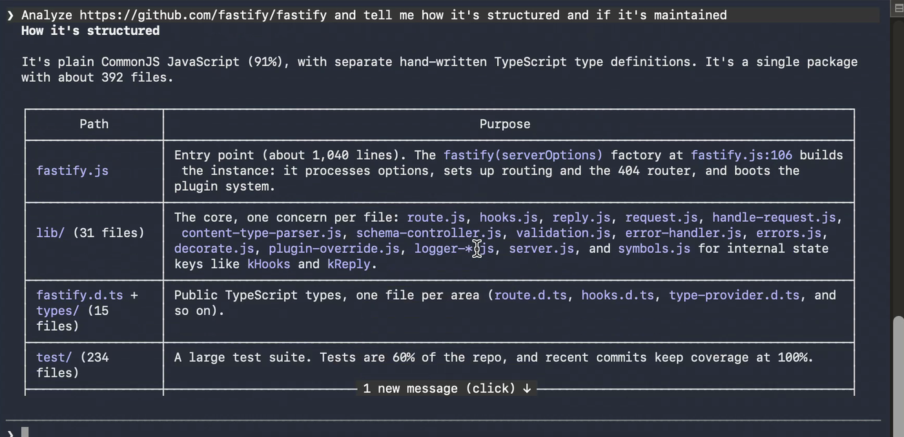
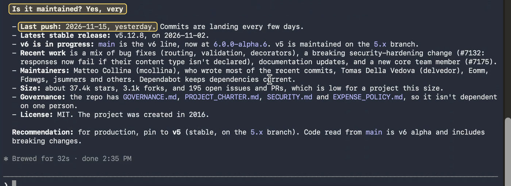

<p align="center">
  
</p>

<h1 align="center">Repo Context</h1>

<p align="center">
  <b>Your AI coding agent can now understand any GitHub repository without cloning it.</b>
</p>

<p align="center">
  <a href="#install">Install</a> ·
  <a href="https://www.agensi.io/skills/repo-context-understand-any-github-repo">Agensi</a> ·
  <a href="#tools">Tools</a> ·
  <a href="#command-line">CLI</a>
</p>

<p align="center">
  <a href="https://github.com/Elarionitis/repo-context-mcp/actions/workflows/ci.yml"></a>
  
  
</p>

---

Paste a GitHub link or `owner/name` into Claude Code, Cursor or Copilot. One call gives your agent the tech stack, folder layout, entry points, run commands, agent instruction files and a README summary. Five more tools let it browse the tree, find files, read code, search, and check recent activity.

Works with Claude Code, Cursor, VS Code Copilot, Claude Desktop, Windsurf, Codex CLI, Gemini CLI and any other MCP client, and as a plain command line tool for agents that can run shell commands.



The same call answers whether a dependency is worth adopting, from the repository's releases, commits and maintainers rather than from training data:



## Install

One command. It finds the AI agents on your computer and installs the skill for them:

```bash
npx -y github:Elarionitis/repo-context-mcp install-skill
```

Restart your agent, then ask it:

> Analyze expressjs/express

That is the whole setup. You need [Node.js 20 or newer](https://nodejs.org), and the first run takes about 20 seconds while it downloads.

If more than one agent is found, it asks which ones to install for:

```text
Found these AI agents on your computer:
  1. Claude Code
  2. Gemini CLI
  3. Cursor

Press Enter to install for all, or type numbers (e.g. 1,3): 1

Installed the repo-context skill for:
  ✓ Claude Code     ~/.claude/skills/repo-context
```

The skill is also listed free on [Agensi](https://www.agensi.io/skills/repo-context-understand-any-github-repo), if you would rather install from a marketplace.

<details>
<summary><b>Never opened a terminal?</b></summary>

- **Mac:** press `Cmd + Space`, type **Terminal**, press Enter
- **Windows:** press the Windows key, type **PowerShell**, press Enter
- **Linux:** open your terminal app

Paste the command above and press Enter. To check that Node.js is there first, run `node --version`: it should print 20 or higher. If not, install the LTS version from [nodejs.org](https://nodejs.org) and open the terminal again.

</details>

<details>
<summary><b>One agent only, another folder, or uninstalling</b></summary>

Pick agents with `--agent` (`claude`, `codex`, `gemini`, `copilot`, `cursor`, or `all`), separated by commas:

```bash
npx -y github:Elarionitis/repo-context-mcp install-skill --agent claude,cursor
```

Other options:

- `--yes`: install for every agent found, without asking
- `--dir <folder>`: install into any other skills folder

Where it goes:

| Agent | Skill folder (found automatically) |
|-------|------------------------------------|
| Claude Code | `~/.claude/skills` |
| Codex CLI | `~/.codex/skills` |
| Gemini CLI | `~/.gemini/skills` |
| GitHub Copilot (VS Code, CLI) | `~/.copilot/skills` |
| Cursor | reads the Claude Code or Codex folder, otherwise `~/.cursor/skills` |

Update it by running the install command again. Remove it with:

```bash
npx -y github:Elarionitis/repo-context-mcp uninstall-skill
```

</details>

### As an MCP server instead

For Claude Desktop, Windsurf, or any client you would rather give native tools.

**Claude Code**, one command:

```bash
claude mcp add repo-context --scope user -- npx -y github:Elarionitis/repo-context-mcp
```

**Cursor** (`~/.cursor/mcp.json`), **Claude Desktop**, **Windsurf** and **Gemini CLI** use the same shape:

```json
{
  "mcpServers": {
    "repo-context": {
      "command": "npx",
      "args": ["-y", "github:Elarionitis/repo-context-mcp"]
    }
  }
}
```

<details>
<summary>VS Code Copilot and Codex CLI</summary>

**VS Code Copilot** (`.vscode/mcp.json`):

```json
{
  "servers": {
    "repo-context": {
      "type": "stdio",
      "command": "npx",
      "args": ["-y", "github:Elarionitis/repo-context-mcp"]
    }
  }
}
```

**Codex CLI** (`~/.codex/config.toml`):

```toml
[mcp_servers.repo-context]
command = "npx"
args = ["-y", "github:Elarionitis/repo-context-mcp"]
```

</details>

Restart your agent after adding it. The first start downloads and builds the server, which takes about 10 to 20 seconds.

### Or try it with no install at all

```bash
npx -y github:Elarionitis/repo-context-mcp analyze expressjs/express
```

Every tool works this way. The commands are under [Command line](#command-line).

### GitHub token (optional)

You often will not need one. `analyze` uses 3 API requests, `tree` and `find` use 1, and `read` uses none, because file contents come from `raw.githubusercontent.com`. Results are cached for 10 minutes.

Set `GITHUB_TOKEN` (or `GH_TOKEN`) to:

- read private repositories
- use `search_repo_code`
- raise the rate limit from 60 to 5,000 API requests per hour

A [fine-grained token](https://github.com/settings/personal-access-tokens) with read-only access is enough. Add it to the `env` block of your MCP config, or with Claude Code:

```bash
claude mcp add repo-context --scope user -e GITHUB_TOKEN=your_token -- npx -y github:Elarionitis/repo-context-mcp
```

## Why

Coding agents do well with code they can see. When you ask about a library or a project that isn't on your machine, they guess from old training data, or you end up pasting READMEs and file trees into the chat.

Repo Context fetches that context live from GitHub and shapes it for an LLM: compact markdown, noise removed, and the details an agent actually needs to start working. No LLM API is involved. It's fast, deterministic and free to run.

<details>
<summary>What one <code>analyze</code> call returns</summary>

```text
> Analyze vercel/next.js

# vercel/next.js
> The React Framework

- **Branch:** canary (default)
- **Stars:** 143,519 · **Forks:** 32,804 · **Open issues + PRs:** 3,979
- **License:** MIT
- **Last push:** 2026-11-14 (today)

## Languages
JavaScript 47% · TypeScript 35% · Rust 16%

## Tech stack
- **Frameworks & libraries:** Next.js, React, Express, Tailwind CSS, Tokio, Serde, ...
- **Testing:** Jest, Playwright, Cypress, Vitest, Testing Library
- **Build & tooling:** TypeScript, Turborepo, esbuild, ESLint, Prettier, Webpack
- **Infra & deploy:** GitHub Actions, Docker, Vercel
- **Package managers:** pnpm, Cargo
- **Monorepo:** Turborepo

## Layout
33,820 files (not counting folders like node_modules or dist).
- `crates/` 1,238 files - Rust crates
- `docs/` 479 files - documentation
- `packages/` 3,758 files - workspace packages
- ...

## Instructions for AI agents
- AGENTS.md

## How to run
Install: `pnpm install`
- `pnpm dev` - turbo run dev --parallel ...
- `pnpm build` - turbo run build ...
- `pnpm test` - scripts/run-jest.sh ...

## Next steps
- read_repo_file "AGENTS.md" for the maintainers' agent rules
- get_repo_tree with path "packages" to see the code layout
```

</details>

## Tools

Every tool takes `repo` as `owner/name` or any github.com URL (including `/tree/...` and `/blob/...` links), plus an optional `ref` for a branch, tag or commit.

| Tool | What it does |
|------|--------------|
| `analyze_github_repo` | Overview: description, languages, stack detected from manifests, layout, entry points, agent instruction files, install and run commands, README summary |
| `get_repo_tree` | File tree for the repo or a subfolder, with a depth limit. Deep folders show file counts |
| `find_repo_files` | Find files by substring (`auth`) or glob (`*.test.ts`, `src/**/route.ts`) |
| `read_repo_file` | Read a file with line numbers, 400 lines at a time, with `start_line` / `end_line` |
| `search_repo_code` | Full-text code search with snippets (needs `GITHUB_TOKEN`) |
| `get_repo_activity` | Recent commits, latest release, open issues and top contributors |

### What it detects

- **Manifests:** `package.json`, `pyproject.toml`, `requirements.txt`, `Pipfile`, `setup.py`, `go.mod`, `Cargo.toml`, `Gemfile`, `composer.json`, `pom.xml`, `build.gradle`, `pubspec.yaml`, `Makefile`, including packages inside monorepos
- **Frameworks:** Next.js, React, Vue, Svelte, Angular, Astro, Express, NestJS, Django, FastAPI, Flask, Gin, Axum, Rails, Laravel, Spring Boot, Flutter and many more
- **Data, AI, testing and tooling:** Prisma, Drizzle, SQLAlchemy, OpenAI and Anthropic SDKs, LangChain, PyTorch, Jest, Vitest, pytest, Playwright, Vite, Turborepo, ESLint, Ruff, ...
- **Infra:** Docker, Compose, GitHub Actions, GitLab CI, Terraform, Helm, Kubernetes, Vercel, Netlify, Fly.io, Cloudflare Workers
- **Agent files:** `AGENTS.md`, `CLAUDE.md`, `GEMINI.md`, `.cursorrules`, `.cursor/rules`, `.windsurfrules`, `.github/copilot-instructions.md`

## Command line

The same tools work from a terminal:

```bash
npx -y github:Elarionitis/repo-context-mcp analyze vercel/next.js
npx -y github:Elarionitis/repo-context-mcp tree facebook/react packages --depth 2
npx -y github:Elarionitis/repo-context-mcp find tokio-rs/axum "*.toml"
npx -y github:Elarionitis/repo-context-mcp read https://github.com/expressjs/express/blob/master/index.js
npx -y github:Elarionitis/repo-context-mcp search facebook/react "useSyncExternalStore"
npx -y github:Elarionitis/repo-context-mcp activity fastapi/fastapi --commits 5
```

Run with `help` for all options. With no arguments, it starts the MCP server on stdio.

## Development

```bash
git clone https://github.com/Elarionitis/repo-context-mcp.git
cd repo-context-mcp
npm install
npm run build
npm test
```

- `npm run dev`: run straight from `src/` (Node 22.18+ runs TypeScript directly)
- `npm run inspect`: open the MCP Inspector against the built server
- `npm run package:skill`: bundle the tool into `skills/repo-context/scripts/` and build `repo-context-skill.zip`
- `node dist/index.js install-skill`: install your local build of the skill into `~/.claude/skills`
- `npm run eval:skill`: check the skill with NVIDIA SkillEvaluator, Tier 1 (setup and Tiers 2-3 in [docs/skillevaluator.md](docs/skillevaluator.md))

### Project layout

```text
src/
  index.ts     entry: MCP server with no args, CLI otherwise
  server.ts    MCP tool definitions
  cli.ts       command line interface
  context.ts   builds the markdown each tool returns
  github.ts    GitHub API client: token, caching, errors
  detect.ts    stack and command detection from manifests
  readme.ts    README cleanup, intro and setup sections
  tree.ts      file tree rendering and file search
  parse.ts     repo name and URL parsing
  install.ts   install-skill and uninstall-skill (finds agents automatically)
test/          node:test tests, no network needed
scripts/       build-skill.mjs bundles the skill script
skills/        agent skill (SKILL.md, setup guide, logo, listing copy)
```

## Contributing

Issues and pull requests are welcome. Good first contributions:

- detection rules for more frameworks and tools (`src/detect.ts`)
- GitLab or Bitbucket support
- more tests

Please run `npm test` before opening a PR.

## Limitations

- GitHub only, no GitLab or Bitbucket yet
- Stack detection reads manifests and file names. It doesn't parse code
- For very large repos (over about 100k files), GitHub returns a partial file tree. The output says when that happens
- Code search only covers the default branch, which is a GitHub limitation

## Author

Suhan Ramani ([@Elarionitis](https://github.com/Elarionitis))

## License

[MIT](LICENSE)
